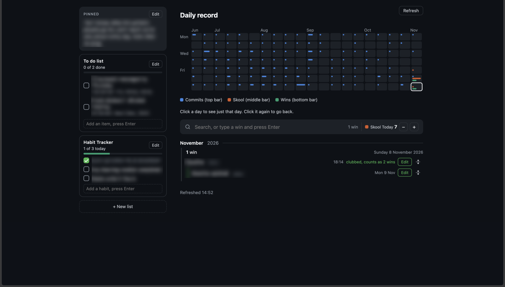
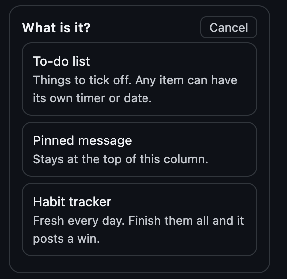
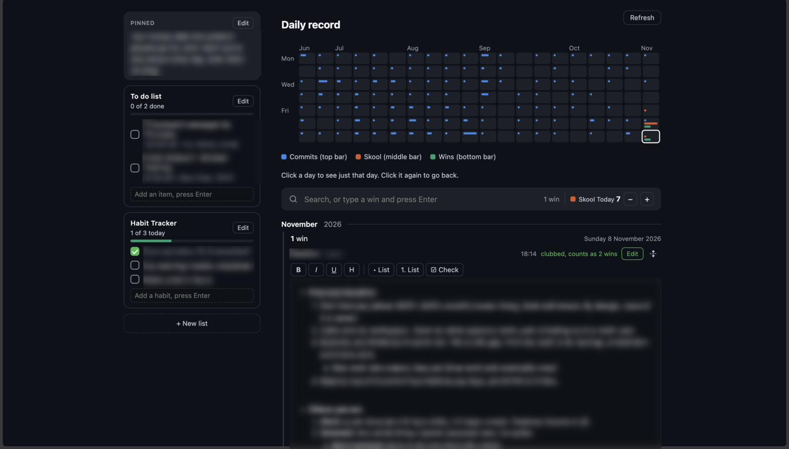
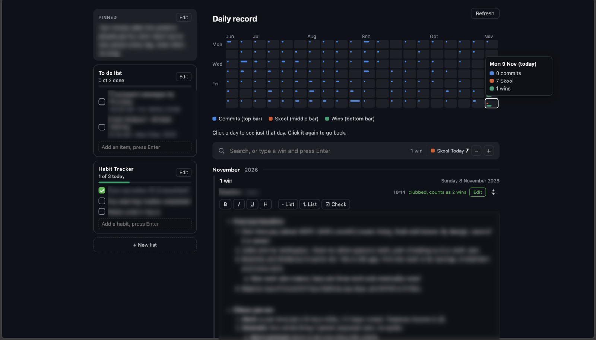

# Am I Working

A private daily tracker that runs on your own computer. One page shows whether you
actually worked today: a calendar grid, a to-do list, a habit tracker, pinned
reminders and notes. Nothing is sent anywhere. Your data stays in a folder on your
machine.

## 1. Download

1. Click the green **Code** button at the top of this page, then **Download ZIP**.
2. Open the downloaded ZIP so it becomes a folder. Put the folder somewhere you
   will find it (for example, Documents).

## 2. Install Node.js (once)

Go to <https://nodejs.org> and click the big **LTS** button. Install it like any
other program.

## 3. Start it

- **Mac:** double-click `start-mac.command`. (If the Mac complains, right-click the
  file, choose **Open**, then **Open** again.)
- **Windows:** double-click `start-windows.bat`. (Not tested yet. If it fails, use
  the "Any computer" steps below.)
- **Any computer:** open a terminal in the folder and type `node app/server.js`,
  then open <http://127.0.0.1:8788> in your browser.

Keep the black window open while you use it. Close it to stop.

## 4. Use it

The page has two columns. Everything is saved the moment you change it.

**Left column**
- **Pinned message:** a note that stays on top. Click **Edit** to change it.
- **To do list:** type in the box and press Enter. Tick the box when done. An item
  can also have a date or timer.
- **Habit tracker:** tick each habit once a day. It starts fresh every day. Tick
  them all and it records a win for you.
- **+ New list:** add another list.

**Right column**
- **The grid:** one square per day. Each square has up to three bars: blue =
  commits, orange = Skool, green = wins. Hover a square to see the numbers. Click
  a day to see only that day.
- **The box under the grid:** type a win and press Enter to record it. Use the
  **+** and **-** next to "Skool" to count Skool work. This one is manual.
- **Below that:** your wins by day. Click **notes** to open a notepad for a win,
  with bold, lists, checkboxes and sub-lists (press Tab to indent).

## Settings (the gear button)

Click the gear next to **Refresh**. Everything below is saved on your computer.

- **Theme:** System (follows your computer), Light, Dark or Paper (warm yellow).
- **GitHub commits:** type your GitHub username and paste a read-only token. The blue bars in the grid then fill in by themselves. Skip it and everything else still works. The token is saved on your computer and the page never shows it again.
- **Calendars:** paste a calendar link, give it a name and a colour, press **Add calendar**.
  - **Google:** open Google Calendar on a computer, Settings, click your calendar, Integrate calendar, copy the **Secret address in iCal format**.
  - **Apple:** in the Calendar app, right-click a calendar, **Share Calendar**, tick **Public Calendar**, copy the link.
  - Any other calendar that gives you an `.ics` or `webcal://` link works too.
  - Treat these links like passwords. Anyone who has one can read that calendar.
  - Links are read-only. The app only reads your calendar, it never changes it.
  - Google and Apple decide how fast a link shows changes, from minutes to a few hours. The app checks the links every 5 minutes.

## The calendar

On a wide screen the calendar sits to the right of the grid, using the same boxes as the grid. Click a day to see its events below, hour by hour. Click an event for its details. The quiet hours before 7 am are folded away until you open them. Every event the app has ever seen is also kept in a local copy, even if you later delete it from your calendar.

## The Refresh button colour

Refresh re-reads everything (the page, GitHub and your calendars). Its colour tells you how the last sync went: **green** means everything synced, **red** means something failed (open the gear to see which), **amber** means it is working, and no colour means nothing is connected yet.

## Where is my data?

In a folder called `.am-i-working` in your home folder. It is never inside this
project, so downloading or updating the app never touches it. It holds your tracker
data, your settings (including the GitHub token and calendar links, kept private to
your user) and the local copy of your calendars. To back up, copy that folder.
To change it, set `AMIW_DATA`.

## Settings (all optional)

| Name | Default | What it does |
|---|---|---|
| `PORT` | 8788 | Port the page runs on |
| `HOST` | 127.0.0.1 | Only this computer can open it |
| `AMIW_DATA` | `~/.am-i-working` | Where data is saved |
| `GITHUB_TOKEN`, `GITHUB_LOGIN` | none | Fill the commits bar (or set them under the gear) |
| `CALENDAR_SYNC_MINUTES` | 5 | How often calendar links are re-read |
| `COMMITS_TTL_HOURS` | 24 | How often commits are re-fetched |

## Run it all the time (Linux, advanced)

`bash app/install.sh` sets it up as a background service that starts at login.

## Files

- `app/index.html`: the whole page
- `app/server.js`: the small server, no extra packages needed
- `app/calendar.js`: reads calendar links and works out the events for each day
- `test/`: automatic tests for the calendar code
- `design/`: early design samples with made-up data
- `docs/`: the pictures above (personal text blurred)

## Rules for this repo

No personal data, hostnames, tokens or addresses in any tracked file.

## Contributing

Pull requests are welcome. A check runs on every pull request (privacy scan,
image metadata, syntax, calendar tests, start-up test). Run it yourself first with
`bash .github/scripts/check.sh`. Only the owner merges.
